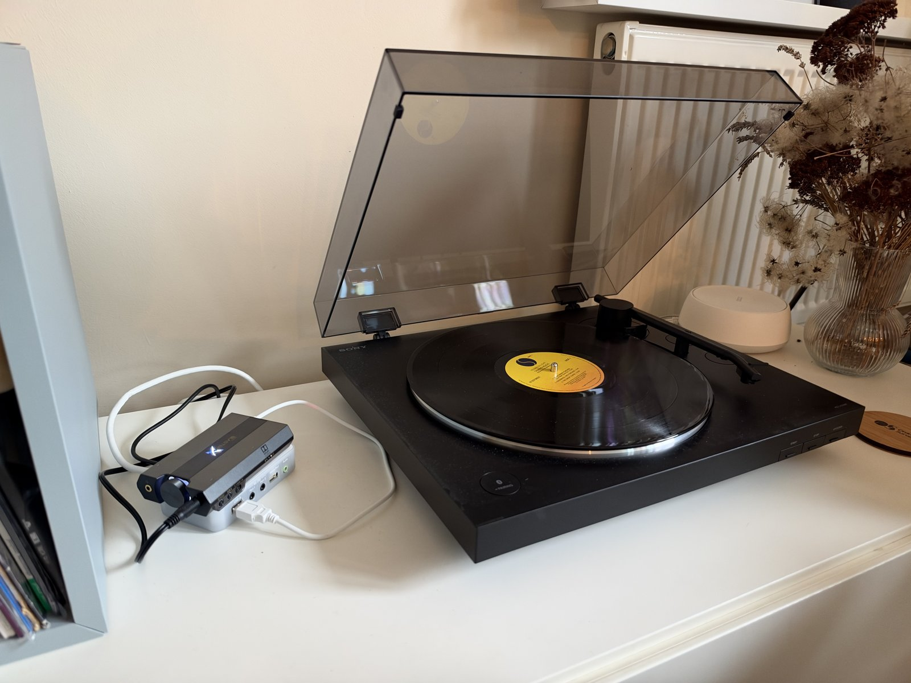
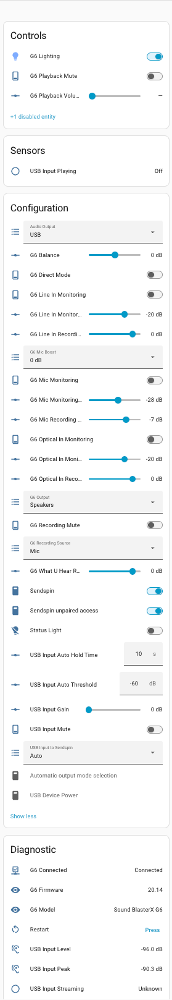

# Home Assistant Connect AUX-2 + Sound Blaster X G6

Custom firmware for the [Home Assistant Connect AUX-2](https://www.home-assistant.io/connect/aux-2/) that turns a Creative Sound Blaster X G6 into a USB sound card for it. With it, the AUX-2 can play music through the G6, and anything plugged into the G6 (a turntable, a mic, a line-level source) can be shared to Music Assistant as a Sendspin source.

In my setup, a turntable plugs into the G6 and the G6 plugs into the AUX-2 over USB. The record shows up in Music Assistant, and I can play it in sync on any other Sendspin speaker in the house.

There's a short [video of it working](media/demo.mp4).

This is a personal project, not an official Nabu Casa product. It's built on the official [AUX-2 firmware](https://github.com/NabuCasa/aux-2).

## What it does

- Adds USB as a third audio output on the AUX-2, next to the built-in analog (3.5 mm) and digital (optical) outputs. Sendspin, Music Assistant and Home Assistant announcements can all play through the G6.
- Shares the G6's input with Sendspin, so Music Assistant can stream whatever is plugged into the G6 to other speakers. In Auto mode, the input is offered only while there's actually sound on it.
- Controls the G6 from Home Assistant: which input it records, recording and monitoring levels, playback volume, balance, and a few of Creative's own settings.
- Keeps the AUX-2's two RS-232 serial ports, Ethernet with PoE, and Wi-Fi.

Bluetooth and the USB Z-Wave and Zigbee dongle support are removed, so the USB port is free for the G6 and there's more memory for audio.

## What you need

- A Home Assistant Connect AUX-2
- A Sound Blaster X G6, connected to the AUX-2's USB port
- Home Assistant with the **dev** version of the ESPHome Device Builder. As of November 2026, the USB audio support this relies on is only in ESPHome's development builds, so the regular release won't build it yet.
- Music Assistant, if you want to use the G6's input as a Sendspin source

## Installing

1. Switch the ESPHome Device Builder to its dev version, then copy `aux-2-g6.yaml` into it.
2. Add your Wi-Fi details and an API key to your `secrets.yaml`. There's an example in `secrets.yaml.example`.
3. Build and install. The first install has to be done over USB-C, because the AUX-2's factory firmware only accepts signed updates over the network. After that, updates work over the network as usual.

The device keeps its `connect-aux-2-xxxxxx` name, so Home Assistant keeps the same device.

## How it uses ESPHome's USB Audio component

The heavy lifting is done by ESPHome's new [USB Audio component](https://next.esphome.io/components/usb_audio/). It lets the AUX-2's chip act as the "computer" for a USB sound card, the same way a laptop would, as long as the card follows the standard USB audio rules (most do, including the G6).

The firmware uses it in three ways:

- Playing audio on the G6: the component's speaker part is the third audio output, alongside the AUX-2's own analog and optical outputs. Whatever the AUX-2 plays (Sendspin, Music Assistant, announcements) goes to whichever output you pick in Audio Output.
- Recording from the G6: the component's microphone part receives whatever the G6 is recording. That feeds the Sendspin source, so Music Assistant can stream it, and the level meters that drive Auto mode.
- Talking to the G6: the same USB connection carries the commands that change the G6's settings, like the recording source and volumes.

The component sends and receives audio in one fixed format, and the sound card has to support it. If it doesn't, the component writes the formats the card does support to the log. That's how we found out the G6 only offers 24-bit at the AUX-2's USB speed (more on that below).

The component also handles the G6 being unplugged and plugged back in while the AUX-2 is running.

## Settings you can control

### Audio output

| Setting | What it does |
|---|---|
| Audio Output | Picks where audio plays: Analog (3.5 mm), Digital (optical) or USB (the G6). |
| Automatic output mode selection | Switches between Analog and Digital when you plug a cable into the AUX-2's audio jack. It never switches away from USB. Hidden by default. |
| Media Player | Plays media and announcements from Home Assistant. |

### Sharing the G6's input with Sendspin

| Setting | What it does |
|---|---|
| USB Input to Sendspin | Off, On or Auto. Auto offers the input only while sound is playing on it. |
| USB Input Mute | Silences the input. |
| USB Input Gain | Extra digital boost on the audio sent to Sendspin, 0 to 36 dB. |
| USB Input Auto Threshold | How loud the input has to be before Auto counts it as playing. |
| USB Input Auto Hold Time | How long Auto keeps the input shared after it goes quiet, so it doesn't drop between tracks. |
| USB Input Playing | Shows whether sound is detected on the input. |
| USB Input Streaming | Shows whether Music Assistant is pulling the input right now. |
| USB Input Level and USB Input Peak | How loud the input is. -120 dB means silence. A peak near 0 dB means it's clipping. |

### G6 recording

| Setting | What it does |
|---|---|
| G6 Recording Source | Which G6 input is recorded and shared: Mic, Line In, Optical In or What U Hear. |
| G6 Mic, Line In, Optical In and What U Hear Recording Volume | The G6's own recording level for each input, -48 to +9 dB. Turn these up before using USB Input Gain, since it gives a cleaner result. |
| G6 Mic Boost | 0, 10, 20 or 30 dB of extra gain for the mic input. |
| G6 Recording Mute | Mutes recording on the G6 itself. |

### G6 playback and monitoring

| Setting | What it does |
|---|---|
| G6 Playback Volume | The G6's volume. |
| G6 Playback Mute | Mutes the G6. |
| G6 Balance | Shifts the sound left or right, up to 20 dB either way. |
| G6 Output | Speakers or Headphones. |
| G6 Direct Mode | Skips the G6's sound effects and EQ. |
| G6 Mic, Line In and Optical In Monitoring | Plays that input through the G6's own headphone or speaker outputs. |
| G6 Mic, Line In and Optical In Monitoring Volume | How loud each monitored input is, -64 to 0 dB. |
| G6 Lighting | The color of the G6's logo light, or off. |

### Device and diagnostics

| Setting | What it does |
|---|---|
| G6 Connected, G6 Model and G6 Firmware | Whether the AUX-2 can see the G6, and which G6 and firmware it is. |
| USB Device Power | Turns power to the USB port off and on, to restart the G6. |
| Sendspin and Sendspin unpaired access | Turn Sendspin on or off, and choose whether servers have to pair first. |
| Status Light | The AUX-2's own LED. |
| Restart and Factory Reset | Restart the AUX-2, or wipe its settings. Factory Reset is hidden by default. |

G6 Output, G6 Direct Mode, G6 Mic Boost and G6 Lighting use Creative's own commands rather than the standard USB audio ones. They're only sent when you change them, and the G6 can't report them back. So if you change one on the G6 itself or from a computer, Home Assistant will keep showing the old value.

## Why the G6 runs at 24-bit

The firmware handles audio at 16-bit, but the USB link to the G6 runs at 24-bit. That's because of how the G6 works with the AUX-2, not a setting you can change.

When a USB sound card connects, it sends a list of the audio formats it supports, and the device it's plugged into picks one. The G6 sends a different list depending on how fast the USB connection is. Plugged into a computer over USB 2.0, it offers 16, 24 and 32-bit at rates up to 192 kHz. The AUX-2's chip only supports the older USB 1.1 speed, and at that speed the G6 offers exactly one format: 48 kHz, 24-bit, stereo, for both playback and recording.

Setting the G6 to 16-bit on a computer doesn't change this. That setting tells the computer which format to pick, and the G6 forgets it as soon as it's plugged into something else.

It doesn't cost anything in sound quality. The firmware pads each 16-bit sample out to 24 bits on the way to the G6, and drops the extra bits on the way back, so the audio arrives unchanged.

For reference, the most USB 1.1 can carry is about 24-bit/96 kHz stereo in one direction. 24-bit/192 kHz doesn't fit at all.

## Possible future improvements

- More of Creative's settings, using the same method as the ones above: SBX effects (Surround, Crystalizer, Bass, Smart Volume, Dialog Plus), sound profiles, Voice Clarity (noise reduction and echo cancellation), mic EQ presets, decoder mode and the DAC filter.
- Reading Creative's settings back from the G6, so Home Assistant always shows the real state.
- Bass, treble or loudness controls, if the G6 offers them over standard USB audio. The firmware logs which controls the G6 supports when it connects.
- Recovering playback automatically if the G6 disconnects and reconnects. Right now, playback can stall until the AUX-2 restarts.
- G6 Playback Volume doesn't show a value yet, so its readback needs looking at.
- An option for 24-bit Sendspin playback, since the link to the G6 is 24-bit anyway.
- Support for other USB sound cards. Some offer 24-bit/96 kHz at USB 1.1 speed, which the AUX-2 can handle for playback.

## Credits

- [NabuCasa/aux-2](https://github.com/NabuCasa/aux-2), the official AUX-2 firmware this is based on
- [ESPHome](https://esphome.io), including its USB audio and Sendspin components
- [soundblaster-x-g6-cli](https://github.com/nils-skowasch/soundblaster-x-g6-cli), whose USB captures document the G6's settings commands

## License

Same as the firmware it's based on: the ESPHome License. See [LICENSE](LICENSE).
